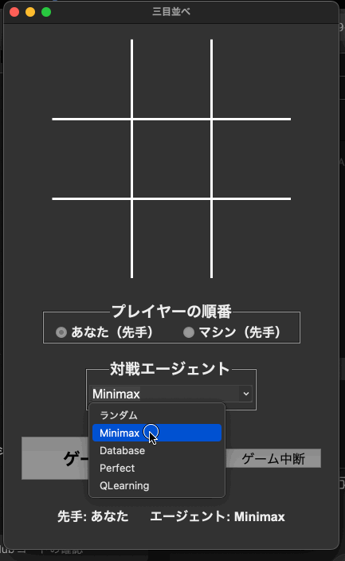

# Tic-Tac-Toe AI Project

これは、様々なAIエージェントで三目並べ（Tic-Tac-Toe）をプレイするためのプロジェクトです。GUIを介して人間がAIと対戦したり、AI同士を対戦させたりすることができます。FastAPIサーバーを介してCUIクライアントとも連携可能です。



## 目次

- [Tic-Tac-Toe AI Project](#tic-tac-toe-ai-project)
  - [目次](#目次)
  - [主なファイルの説明](#主なファイルの説明)
  - [実装されているエージェント](#実装されているエージェント)
  - [使い方](#使い方)
    - [1. GUIアプリケーションの実行](#1-guiアプリケーションの実行)
    - [2. CUI Server/Clientアプリケーションの実行](#2-cui-serverclientアプリケーションの実行)
      - [前提条件](#前提条件)
      - [サーバーの起動](#サーバーの起動)
      - [クライアントの実行](#クライアントの実行)
    - [3. Q学習エージェントの管理 (CLI)](#3-q学習エージェントの管理-cli)
      - [Q学習エージェントの学習](#q学習エージェントの学習)
      - [Q学習エージェントの強さ評価](#q学習エージェントの強さ評価)
      - [モデル同士の性能比較](#モデル同士の性能比較)
  - [ChatGPT AI の設定](#chatgpt-ai-の設定)
  - [開発者向け情報](#開発者向け情報)
    - [セットアップ](#セットアップ)
    - [テストの実行](#テストの実行)
    - [テストカバレッジの集計](#テストカバレッジの集計)
    - [Lintチェックの実行](#lintチェックの実行)
    - [コードフォーマットの実行](#コードフォーマットの実行)
    - [コード品質とカバレッジサマリー](#コード品質とカバレッジサマリー)
  - [ライセンス](#ライセンス)

## 主なファイルの説明

*   `main.py`: アプリケーションのエントリーポイント。GUIを起動します。
*   `gui.py`: メインのGUIウィンドウを構築します。AIエージェントの選択肢は動的に読み込まれます。
*   `game_logic.py`: 三目並べのゲームロジック（勝利判定、手番管理など）を担います。
*   `server/server.py`: FastAPIを使用したゲームサーバーの実装。CUIクライアントからのリクエストを処理し、依存性注入を通じてゲームロジックおよび動的に検出されたエージェントと連携します。
*   `CUI/client.py`: Server/Clientモデルで三目並べをプレイするためのCUIクライアント（Python版）。ユーザーからの入力を受け付け、サーバーと通信します。
*   `rust/CUI/src/main.rs`: Server/Clientモデルで三目並べをプレイするためのCUIクライアント（Rust版）。ユーザーからの入力を受け付け、サーバーと通信します。
*   `agent_discovery.py`: `agents/`ディレクトリをスキャンし、利用可能なAIエージェントを動的に検出・ロードし、表示名とクラスのマッピングを提供する共通モジュールです。GUIとCUI（サーバー経由）の両方で利用されます。
*   `board_drawer.py`: ゲームボードの描画を担当します。
*   `train_q_learning.py`: Q学習エージェントのモデル（`q_table.json`）を生成するための学習スクリプトです。
*   `verify_q_learning_strength.py`: 学習済みQ学習エージェントの強さ評価スクリプト。
*   `evaluate_models.py`: 2つのQ学習モデル同士を対戦させて優劣を評価するスクリプトです。
*   `create_database.py`: `perfect_agent`が使用する必勝手データベース（`tictactoe.db`）を作成します。

## 実装されているエージェント

`agents/` ディレクトリには、異なるアルゴリズムで動作するAIエージェントが含まれています。これらのエージェントは、`agent_discovery.py`モジュールによって動的に検出され、GUIおよびCUIクライアントで統一された選択肢として提供されます。

*   `random_agent.py`: ランダムに手を選択する最も基本的なエージェント。
*   `minimax_agent.py`: ミニマックス法を用いて最適な手を探索するエージェント。
*   `q_learning_agent.py`: Q学習によって学習したQテーブルを元に行動を決定するエージェント。
*   `chatgpt_agent.py`: OpenAIのAPIを利用して次の一手を決定するエージェント。
*   `perfect_agent.py`: `perfect_moves.json` または `tictactoe.db` にある必勝手のデータを元に行動するエージェント。
*   `database_agent.py`: データベースに接続して手を決定するエージェントの基盤。

## 使い方

### 1. GUIアプリケーションの実行

以下のコマンドで三目並べのGUIアプリケーションを起動できます。AIエージェントの選択肢は自動的に検出され、統一されたラベルで表示されます。

```bash
python main.py
```

### 2. CUI Server/Clientアプリケーションの実行

Server/Clientモデルで三目並べをCUIでプレイすることができます。サーバーとクライアントの両方で、GUIと同じ統一されたエージェント選択肢が提供されます。

#### 前提条件

このアプリケーションを実行するには、`uvicorn`と`requests`ライブラリが必要です。インストールされていない場合は、以下のコマンドでインストールしてください。

```bash
pip install uvicorn fastapi requests
```

#### サーバーの起動

プロジェクトのルートディレクトリで、以下のコマンドを実行してFastAPIサーバーを起動します。

```bash
uvicorn server.server:app --app-dir . --reload
```
- `--app-dir .`: `server/server.py`が`game_logic.py`を正しくインポートできるように、現在のディレクトリをアプリケーションの検索パスに追加します。
- `--reload`: 開発中にコードが変更された際に、自動的にサーバーを再起動します。

#### クライアントの実行

サーバーが起動したら、**別のターミナル**を開き、プロジェクトのルートディレクトリで以下のコマンドを実行してCUIクライアントを起動します。

**Python版クライアント**
```bash
python3 CUI/client.py
```

**Rust版クライアント**
Rust版CUIクライアントを実行するには、まずビルドが必要です。
```bash
cd rust/CUI
cargo run
```

クライアントアプリケーションは、空いているマスに1から9の数字を表示します。この数字を入力することで、そのマスに手を進めることができます。

### 3. Q学習エージェントの管理 (CLI)

#### Q学習エージェントの学習

`train_q_learning.py` を使ってQ学習エージェントを学習させ、`q_table.json` を生成・更新します。

```bash
# 10万回のエピソードで学習
python train_q_learning.py --episodes 100000

# 既存のQテーブルに追加で5万回学習
python train_q_learning.py --episodes 50000 --continue_training
```

#### Q学習エージェントの強さ評価

`verify_q_learning_strength.py` を使って、学習させたエージェントが他のAI（ランダム、ミニマックス、完全AI）に対してどの程度の強さかを確認できます。

```bash
# 各AIと1000回ずつ対戦して評価
python verify_q_learning_strength.py --num_games 1000
```

#### モデル同士の性能比較

`evaluate_models.py` を使って、2つの異なるQ学習モデル（`.json`ファイル）の性能を直接対決させて比較できます。

```bash
python evaluate_models.py --model1 q_table_A.json --model2 q_table_B.json --num_games 500
```

## ChatGPT AI の設定

`ChatGPTAgent`を使用するには、OpenAIのAPIキーが必要です。以下の環境変数を設定してください。

```bash
export OPENAI_API_KEY='your_openai_api_key'
```

または、プロジェクトのルートディレクトリに`.env`ファイルを作成し、そこにキーを記述することもできます。

```.env
OPENAI_API_KEY='your_openai_api_key'
```

## 開発者向け情報

### セットアップ

1.  **Python 依存関係のインストール:**
    ```bash
    pip install -r requirements.txt
    ```

2.  **Rust ツールチェインのインストール:**
    Rustプロジェクトをビルドおよびテストするためには、Rustツールチェインが必要です。`rustup`を使用してインストールしてください。
    ```bash
    curl --proto '=https' --tlsv1.2 -sSf https://sh.rustup.rs | sh
    ```
    詳細については [rustup.rs](https://rustup.rs/) を参照してください。

3.  **Rust 用カバレッジツールのインストール (任意):**
    Rustコードのカバレッジを測定するために `cargo-llvm-cov` を推奨します。
    ```bash
    cargo install cargo-llvm-cov
    ```

4.  **必勝手データベースの作成（任意）:**
    `perfect_agent` が使用するデータベースを作成します。
    ```bash
    python create_database.py
    ```
    これにより、`tictactoe.db`が生成されます。

### テストの実行

プロジェクトにはPythonとRustのテストスイートが含まれています。

#### Pythonテストの実行

`pytest` を使ってPythonコードのテストを実行します。
```bash
pytest
```

#### Rustテストの実行

Rustコードのテストは `cargo test` を使って実行します。
`rust/CUI` クライアントのテストを実行するには、該当ディレクトリに移動してコマンドを実行します。
```bash
cd rust/CUI
cargo test
```

### テストカバレッジの集計

テストがプロジェクトのコードをどの程度カバーしているかを集計できます。

#### Pythonカバレッジの集計

`pytest-cov` を使ってPythonコードのカバレッジを測定します。
```bash
# カバレッジを計測し、コンソールに表示
pytest --cov=. --cov-report=term-missing

# HTMLレポートを生成
pytest --cov=. --cov-report=html
open htmlcov/index.html # macOSの場合
```

#### Rustカバレッジの集計

`cargo-llvm-cov` を使ってRustコードのカバレッジを測定します。
```bash
# カバレッジを計測し、コンソールに表示
cd rust/CUI
cargo llvm-cov --text

# HTMLレポートを生成
cd rust/CUI
cargo llvm-cov --html
open target/llvm-cov/html/index.html # macOSの場合
```

### Lintチェックの実行

プロジェクトのコード品質を保つために、`flake8` (Python) と `cargo clippy` (Rust) を使用してLintチェックを行っています。

#### Python Lintチェック

```bash
# testファイルなどを除外してLintチェックを実行
flake8 --exclude=tests,__pycache__,.pytest_cache,build,htmlcov,venv,.venv --max-line-length=120 --statistics --count .
```

#### Rust Lintチェック

```bash
cd rust/CUI
cargo clippy
```

### コードフォーマットの実行

本プロジェクトでは、コードフォーマッターとして `black` (Python) を使用しています。

```bash
black .
```

### コード品質とカバレッジサマリー

本プロジェクトでは、FastAPIサーバーとの連携強化、GUI/CUIでのAIエージェント動的選択機能の導入、そしてコード品質の向上に注力しました。主要コンポーネントのテストカバレッジは以下の通りです。

#### Python関連コード

| ファイル名        | Stmts | Miss | Cover    |
| :---------------- | :---- | :--- | :------- |
| `board_drawer.py` | 37    | 0    | **100%** |
| `game_info_ui.py` | 18    | 0    | **100%** |
| `settings_ui.py`  | 49    | 0    | **100%** |
| `gui.py`          | 167   | 45   | **73%**  |
| `CUI/client.py`   | 13    | 0    | **100%** |
| `CUI/cui_display.py` | 21    | 0    | **100%** |
| `CUI/tic_tac_toe_client.py` | 118   | 0    | **100%** |
| `server/game_manager.py` | 76    | 7    | **91%**  |
| `server/schemas.py`      | 24    | 0    | **100%** |
| `server/server.py`       | 30    | 0    | **100%** |

#### Rust関連コード (`rust/CUI`)

| ファイル名        | 関数カバレッジ | 行カバレッジ |
| :---------------- | :--- | :--- |
| `src/display.rs` | 100.00% | 80.00% |
| `src/game_client.rs` | 100.00% | 94.44% |
| `src/lib.rs` | 100.00% | 68.42% |
| `src/main.rs` | 0.00% | 0.00% |
| **合計** | **91.67%** | **74.19%** |

Lintチェックについても、主要なPythonファイルにおける`flake8`の警告は解消済みです。Rustプロジェクトでも`cargo clippy`の警告は解消済みです。

## ライセンス

このプロジェクトは[MITライセンス](LICENSE)の下で公開されています。
