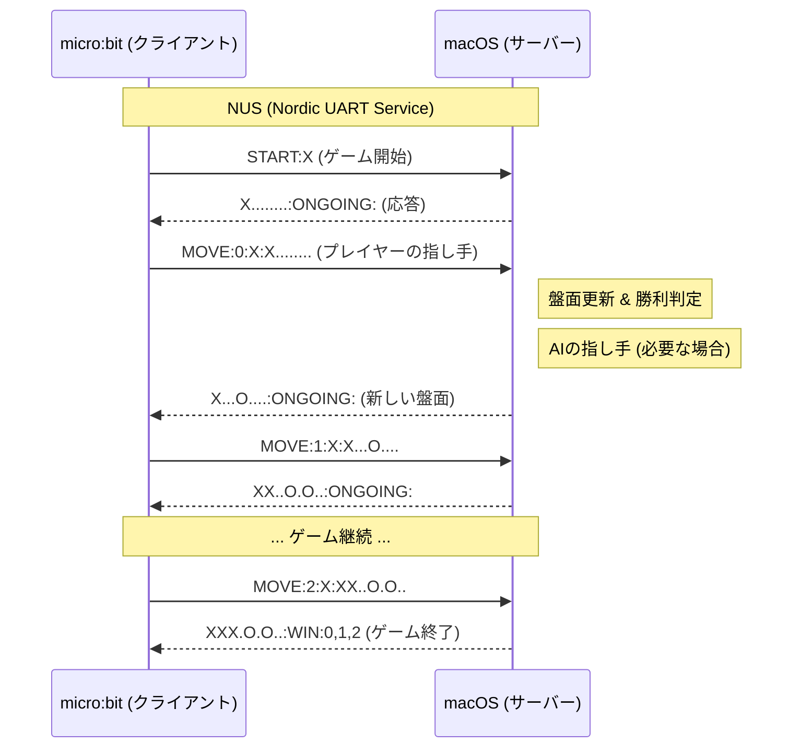

# BLE Tic-Tac-Toe Server

macOS 上で動作し、micro:bit クライアントと BLE (Bluetooth Low Energy) 経由で通信を行う Tic-Tac-Toe (三目並べ) のサーバーです。
`bleak` ライブラリを使用して Nordic UART Service (NUS) をエミュレートし、高度なゲームロジック (AI 対戦など) を提供します。

## 特徴

- **Nordic UART Service (NUS)**: micro:bit との通信に標準的な UART over BLE を使用。
- **Stateless/Stateful Hybrid**: クライアントからのコマンドに応じてゲームの状態を管理·更新します。
- **AI Agent**: サーバー側の強力な AI (Random, Minimax など) と対戦可能。

## 必要要件

- Python 3.9+
- macOS (CoreBluetooth を使用するため)
- `bleak` ライブラリ

## インストール

プロジェクトのルートディレクトリで以下のコマンドを実行して依存関係をインストールしてください。

```bash
pip install bleak
```

## 使用方法

プロジェクトのルートディレクトリから実行します。

```bash
python ble_server/main.py
```

### オプション

- `--agent`: 対戦する AI エージェントを指定します (デフォルト: `Random`)。
  ```bash
  python ble_server/main.py --agent Minimax
  ```

## 通信プロトコル

micro:bit (Client) と macOS (Server) は、文字列ベースの独自プロトコルで通信します。

### サービス & キャラクタリスティック (NUS)

- **Service UUID**: `6E400001-B5A3-F393-E0A9-E50E24DCCA9E`
- **RX UUID (Write)**: `6E400003-B5A3-F393-E0A9-E50E24DCCA9E` (Mac -> micro:bit)
- **TX UUID (Notify)**: `6E400002-B5A3-f393-e0a9-e50e24dcca9e` (micro:bit -> Mac)

### コマンド (Client -> Server)

| コマンド | フォーマット | 説明 |
| :--- | :--- | :--- |
| **START** | `START:<SYMBOL>` | 新しいゲームを開始します。<br>`<SYMBOL>`: 'X' (先攻) または 'O' (後攻) |
| **MOVE** | `MOVE:<IDX>:<SYM>:<BOARD>` | プレイヤーが指し手送信します。<br>`<IDX>`: 盤面のインデックス (0-8)<br>`<SYM>`: プレイヤーのシンボル ('X'/'O')<br>`<BOARD>`: 現在の盤面状態 (例: `X..O.....`) |
| **RESET** | `RESET` | 盤面をリセットします。 |

### レスポンス (Server -> Client)

フォーマット: `<BOARD_STATE>:<GAME_RESULT>:<WIN_LINE>`

- **BOARD_STATE**: 9文字の盤面文字列 (空きマスは `.`)
- **GAME_RESULT**:
    - `ONGOING`: ゲーム継続中
    - `WIN`: プレイヤーの勝利
    - `LOSE`: プレイヤーの敗北
    - `DRAW`: 引き分け
- **WIN_LINE**: 勝利ラインのインデックス (例: `0,4,8`)。勝敗がついていない場合は空文字。

#### 例
- 継続中: `X...O....:ONGOING:`
- 勝利: `X.O.X..O.:WIN:0,4,8`

### シーケンス図


