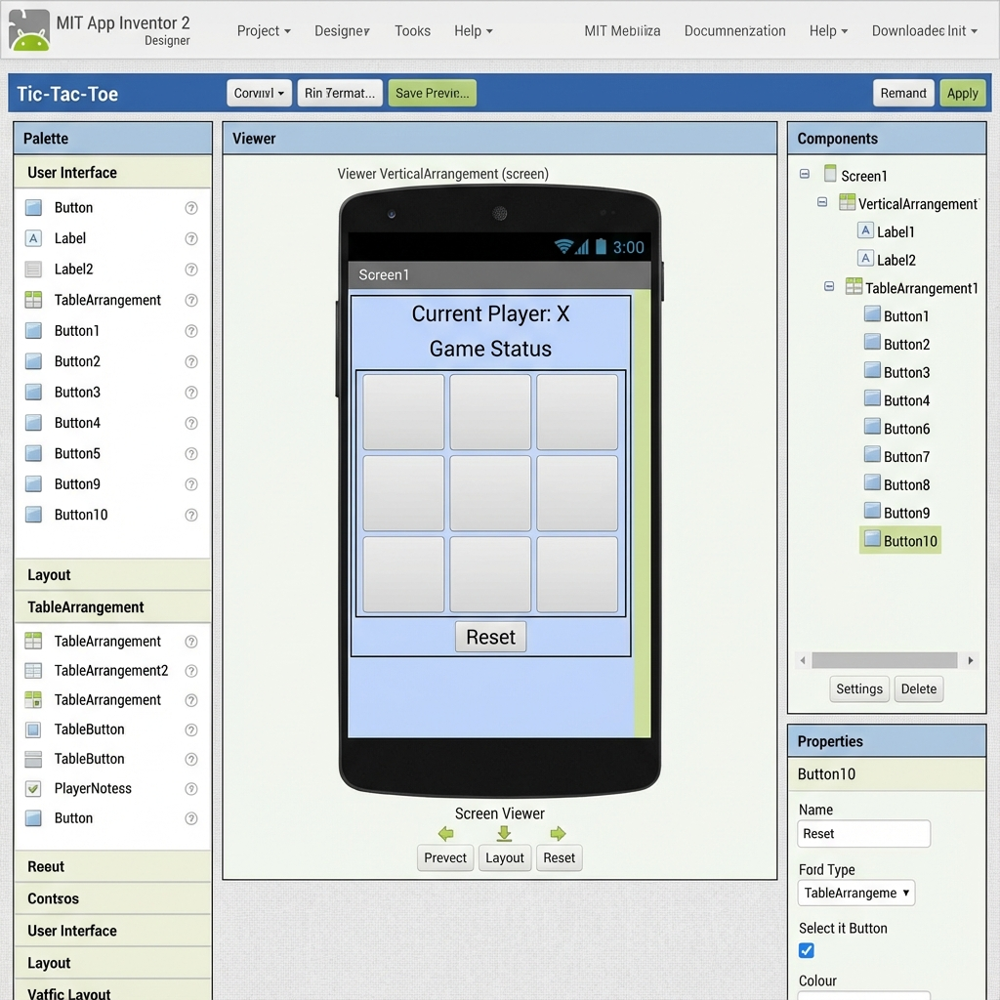
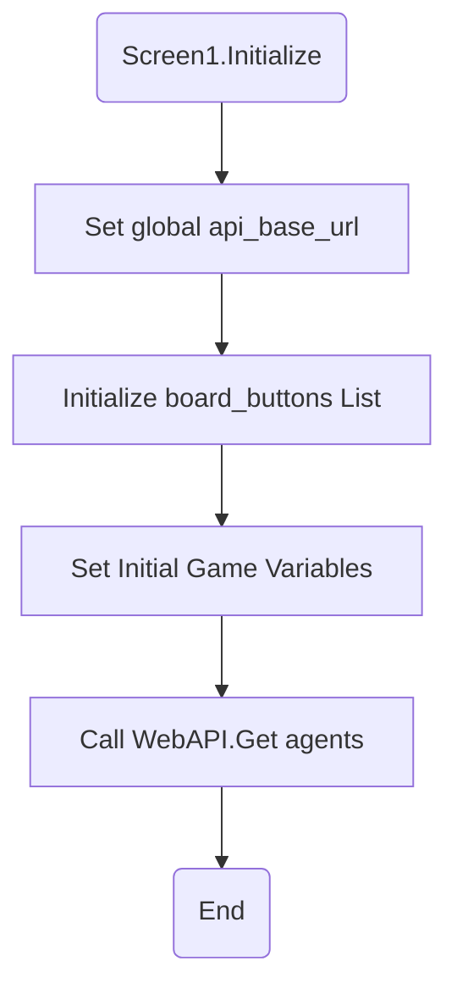
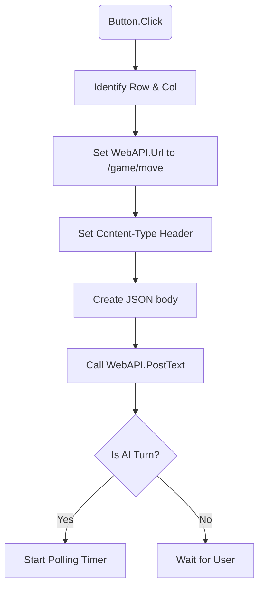
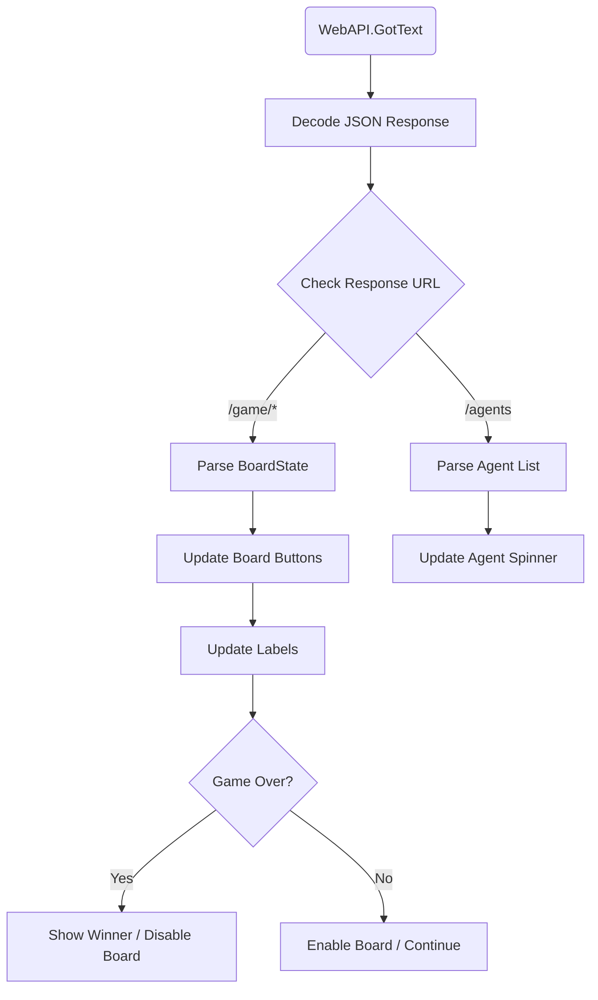
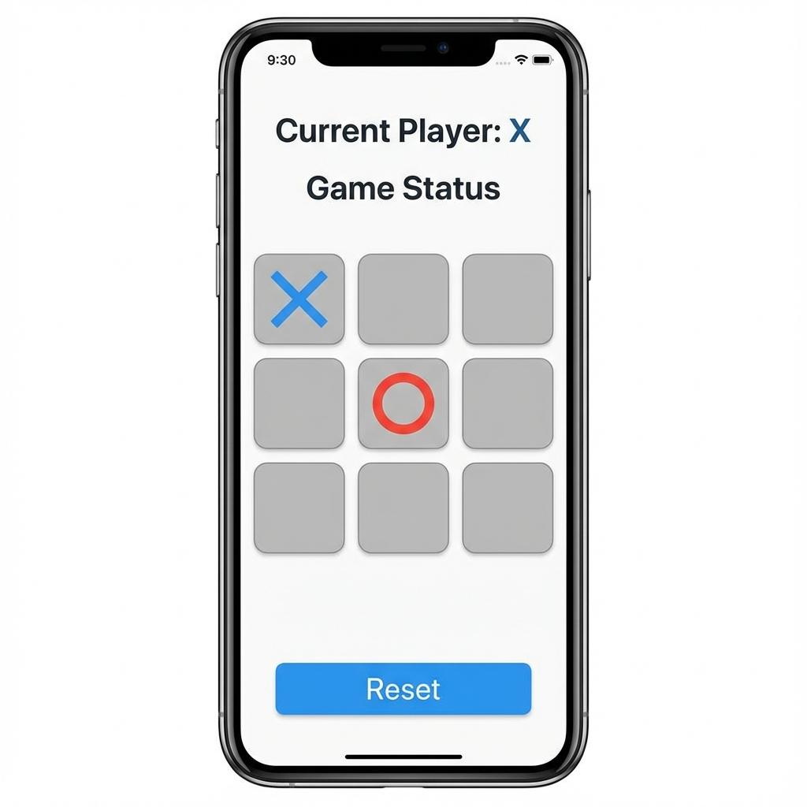

# MIT App Inventor版三目並べアプリ開発ガイド (API連携版)

このガイドは、`server/server.py`によって提供される FastAPI バックエンド API を利用して動作する三目並べ (Tic Tac Toe) アプリを MIT App Inventor で作成するための手順を説明します。

MIT App Inventor はブラウザベースのビジュアルプログラミングツールであるため、直接 `.aia` プロジェクトファイルを生成することはできません。この `README.md` は、プロジェクトを構築する際の設計指針とブロックエディタでの実装ロジックの概要を提供します。

## 1. アプリケーションの概要

プレイヤー（人間またはAI）が三目並べをプレイできるアプリケーションです。ボードの状態はバックエンド API によって管理され、MIT App Inventor アプリは UI の表示とユーザー入力の送信、API レスポンスに基づくボードの更新を行います。

## 2. バックエンド API エンドポイント

アプリが利用する API エンドポイントは以下の通りです。ここでは例として、バックエンドサーバーが `http://localhost:8000` で動作していると仮定します。必要に応じて IP アドレスやポートを変更してください。

* **`POST /game/start`**: 新しいゲームを開始します。
  * **リクエスト:** `StartGameRequest` (JSONボディ)

    ```json
    {
        "human_player_symbol": "X" | "O" | null,
        "player_x_type": "Human" | "Random" | "Minimax" | "QLearning" | "Perfect",
        "player_o_type": "Human" | "Random" | "Minimax" | "QLearning" | "Perfect"
    }
    ```

  * **レスポンス:** `BoardState` (JSON)

    ```json
    {
        "board": [["", "", ""], ["", "", ""], ["", "", ""]],
        "current_player": "X",
        "winner": null,
        "winner_line": null,
        "game_over": false
    }
    ```

* **`GET /game/status`**: 現在のゲームの状態を取得します。
  * **リクエスト:** なし
  * **レスポンス:** `BoardState` (JSON)
* **`POST /game/move`**: プレイヤーの動きを送信します。
  * **リクエスト:** `MoveRequest` (JSONボディ)

    ```json
    {
        "row": 0 | 1 | 2,
        "col": 0 | 1 | 2
    }
    ```

  * **レスポンス:** `BoardState` (JSON)
* **`GET /agents`**: 利用可能なエージェントのリストを取得します。
  * **リクエスト:** なし
  * **レスポンス:** `AvailableAgentsResponse` (JSON)

    ```json
    {
        "agents": ["Human", "Random", "Minimax", "QLearning", "Perfect"]
    }
    ```

## 3. MIT App Inventor プロジェクトのセットアップ

### 3.1. デザイナー画面のコンポーネント配置

推奨される UI コンポーネントの配置は以下の通りです。



**詳細:**

1.  **Layouts -> TableArrangement (1個)**:
    *   名前を `GameBoard` とします。
    *   `Columns` プロパティを `3` に設定します。
    *   `Rows` プロパティを `3` に設定します。
    *   `Width` プロパティを `Fill parent` に設定し、`Height` プロパティも `Fill parent` または適切なパーセンテージに設定して、画面全体に広がるように調整します。
    *   三目並べの9つのマス目の基盤となります。
2.  **User Interface -> Button (9個)**:
    *   `GameBoard` コンポーネント内にドラッグ＆ドロップで配置します。各マス目に対応するように配置し、名前を `Button00` (0行0列) から `Button22` (2行2列) までとします。
    *   **各ボタンのプロパティ設定例:**
        *   `Text`: 空白にするか、初期値として`"- "`などを設定しても構いません。ゲームの進行に合わせて `X` または `O` に変更されます。
        *   `FontSize`: `36` や `48` など、大きく設定して `X` や `O` が見やすいようにします。
        *   `Width`: `Fill parent` に設定して `GameBoard` 内で等しい幅になるようにします。
        *   `Height`: `Fill parent` に設定して `GameBoard` 内で等しい高さになるようにします。
        *   `BackgroundColor`: 任意で設定できます。
3.  **User Interface -> Label (2個)**:
    *   1つ目のラベル: 名前を `CurrentPlayerLabel` とし、現在のプレイヤー (`X` または `O`) を表示するために使用します。例えば、初期値として `Current Player: X` と設定できます。
    *   2つ目のラベル: 名前を `GameStatusLabel` とし、ゲームの状態（「X の勝利！」「引き分け！」「ゲーム進行中...」など）を表示するために使用します。
    *   両方のラベルについて、`FontSize` や `TextColor` などを調整して見やすくします。
4.  **User Interface -> Button (1個)**:
    *   名前を `ResetButton` とし、`Text` プロパティを「リセット」または「New Game」に設定します。
    *   このボタンがクリックされると、新しいゲームが開始されるように API を呼び出します。
5.  **Connectivity -> Web (1個)**:
    *   名前を `WebAPI` とします。
    *   このコンポーネントは画面には表示されませんが、バックエンドの FastAPI API と通信するために必須です。
    *   プロパティはデフォルトのままで構いません。
6.  **Storage -> TinyDB (1個)**: (オプション)
    *   名前を `GameSettingsDB` などとします。
    *   プレイヤータイプ（Human/AI）や AI の種類などのユーザー設定を保存し、アプリが終了しても設定が保持されるようにするために使用できます。

### 3.2. ゲームアセット (画像)

アプリで使用できる基本的なアセット画像を `images/` ディレクトリに生成しました。MIT App Inventor の「Media」ペインにアップロードして使用してください。

*   **Xマーク**: `images/x_mark.svg` ([プレビュー](images/x_mark.svg))
*   **Oマーク**: `images/o_mark.svg` ([プレビュー](images/o_mark.svg))
    *   ボタンの `Image` プロパティに設定することで、テキストの代わりに画像を表示できます。

### 3.3. 変数の定義 (Blocks エディタ)

これらのコンポーネントを画面上部に `CurrentPlayerLabel` と `GameStatusLabel`、中央に `GameBoard`、下部に `ResetButton` といった配置でレイアウトすると良いでしょう。

### 3.2. 変数の定義 (Blocks エディタ)

以下のグローバル変数を定義します。

*   `board_buttons`: 各ボタン (`Button00` - `Button22`) をリストとして格納する変数。これを使ってボタンへのアクセスを簡素化します。
*   `player_x_type`, `player_o_type`, `human_player_symbol`: ゲーム開始時に API に送信するための設定値。
*   `api_base_url`: 例: `http://localhost:8000`

## 4. ブロックエディタでのロジック実装

### 4.1. 画面初期化時 (`Screen1.Initialize`)

1.  `api_base_url` を設定します。
2.  `board_buttons` リストを初期化し、すべてのボタンをリストに追加します。
3.  ゲームの初期設定 (例: `player_x_type` = "Human", `player_o_type` = "Random", `human_player_symbol` = "X") を行います。
4.  `Call WebAPI.Url` を `api_base_url` + `/agents` に設定し、`Call WebAPI.Get` を実行して利用可能なエージェントを取得します。（オプション）
    *   `WebAPI.GotText` イベントでレスポンスを処理し、エージェント選択用の UI (例: `Spinner` や `ListPicker`) を更新します。



**疑似コード:**

```text
// Screen1.Initialize
set global api_base_url to "http://localhost:8000"
add items to list (global board_buttons)
    item: Button00
    item: Button01
    ...
    item: Button22
set global player_x_type to "Human"
set global player_o_type to "Random"
set global human_player_symbol to "X"

set WebAPI.Url to join(global api_base_url, "/agents")
call WebAPI.Get
```

### 4.2. 新しいゲームの開始 (`ResetButton.Click` および初期ゲーム開始時)

1.  `Call WebAPI.Url` を `api_base_url` + `/game/start` に設定します。
2.  `RequestHeaders` に `Key: Content-Type`, `Value: application/json` を設定します。
3.  `RequestContent` を JSON 文字列として作成します。`player_x_type`, `player_o_type`, `human_player_symbol` 変数を使用します。
    *   `make a dictionary` ブロックと `JSON text encode` ブロックを活用します。
    ```json
    {
        "human_player_symbol": "X", // または "O" または null
        "player_x_type": "Human",
        "player_o_type": "Random"
    }
    ```
4.  `Call WebAPI.PostText` を実行します。

### 4.3. ユーザーの動きの送信 (各ボードボタンの `.Click` イベント)

**詳細:**
各ボードボタン (`Button00` から `Button22` まで) に対して、それぞれ `.Click` イベントハンドラーを設定します。または、任意のコンポーネント (`Any Component`) ブロックを使用して、すべてのボタンのクリックイベントをまとめて処理することもできます。

1.  **クリックされたボタンの `row` と `col` を特定します。**
    *   ボタンの名前に基づいて行と列を抽出するのが一般的です。例えば、`Button00` から `Button22` のような命名規則の場合、ボタン名の5文字目が行番号、6文字目が列番号に相当します。
    *   `control` カテゴリの `if` ブロックと `text` カテゴリの `contains text` や `segment` ブロック、または `lookup in pairs` ブロックなどを使って、クリックされたコンポーネントから対応する行と列の値を決定します。
    *   あるいは、よりシンプルな方法として、各ボタンの`.Click`イベントで直接 `row` と `col` の値をハードコードして設定します。（例: `Button00.Click` イベントでは `row = 0`, `col = 0` となるように変数に代入する）
2.  **`WebAPI.Url` を設定します。**
    *   `WebAPI` コンポーネントから `set WebAPI.Url to` ブロックを使用します。
    *   値は `api_base_url` (グローバル変数) と `/game/move` を結合したもの (`join` ブロック) にします。
3.  **`WebAPI.RequestHeaders` を設定します。**
    *   `WebAPI` コンポーネントから `set WebAPI.RequestHeaders to` ブロックを使用します。
    *   `make a list of pairs` ブロックを使って、ヘッダーとして `Key: Content-Type`, `Value: application/json` を設定します。
4.  **`WebAPI.RequestContent` を JSON 文字列として作成します。**
    *   `make a dictionary` ブロックで `{"row": 選択された行, "col": 選択された列}` という構造を作成します。
    *   `JSON text encode` ブロック (`Web` コンポーネントの下にあります) を使用して、この辞書を JSON 形式の文字列に変換し、`set WebAPI.RequestContent to` ブロックで設定します。
    ```json
    {
        "row": クリックされたボタンの行 (0-2),
        "col": クリックされたボタンの列 (0-2)
    }
    ```
5.  **`Call WebAPI.PostText` を実行します。**
    *   `WebAPI` コンポーネントから `call WebAPI.PostText` ブロックを使用します。引数には空の文字列を指定します。
6.  AI プレイヤーの番になった場合、すぐに `Call WebAPI.Url` を `api_base_url` + `/game/status` に設定し、`Call WebAPI.Get` を実行して最新のボード状態を取得するループやタイマーロジックを実装することを検討します。これにより、AI の動きが反映されたボードを更新できます。これは `WebAPI.GotText` イベント内で、APIレスポンスの `current_player` が AI エージェントのタイプである場合にトリガーされるように設定できます。



**疑似コード:**

```text
// ButtonXY.Click (or AnyButton.Click)
local row = get_row_from_button_name(component)
local col = get_col_from_button_name(component)

set WebAPI.Url to join(global api_base_url, "/game/move")
set WebAPI.RequestHeaders to make a list of pairs
    key: "Content-Type", value: "application/json"

local json_body = make dictionary
    row: local row
    col: local col
set WebAPI.RequestContent to call Web.JsonTextEncode(local json_body)

call WebAPI.PostText(text: "")

if (current_player is AI) then
    set Clock1.TimerEnabled to true // Start polling for AI move
```

### 4.4. API レスポンスの処理 (`WebAPI.GotText` イベント)

このイベントは、`WebAPI.Get` または `WebAPI.PostText` が成功したときに発生します。

**詳細:**

1.  **`responseContent` を `JSON text decode` ブロックを使ってディクショナリに変換します。**
    *   `WebAPI` コンポーネントの `GotText` イベントハンドラを使用します。
    *   イベントの引数 `responseContent` を `Web` カテゴリにある `JSON text decode` ブロックに接続し、結果を一時的な変数または直接辞書として扱います。
2.  **レスポンスの `Url` プロパティを使って、どの API コールに対するレスポンスかを判別します。**
    *   `if then else if` ブロックを使用し、イベント引数 `url` が特定のパス (`/game/start`、`/game/move`、`/game/status`、`/agents`) を含むかどうかを `text` カテゴリの `contains text` ブロックでチェックします。
3.  **`/game/start` または `/game/move` または `/game/status` のレスポンスの場合 (`BoardState`):**
    *   デコードされた辞書から、`lookup in dictionary` ブロックを使って `board`、`current_player`、`winner`、`game_over` の値を取得します。
    *   **ボードの更新:**
        *   `for each item in list` ループを使用して `board_buttons` リストを反復処理し、対応するボタンの `Text` プロパティを、取得した `board` データに基づいて更新します。
        *   `board` はリストのリストなので、適切なインデックス (`get item from list` ブロック) を使って `board[row][col]` の値を取得します。
    *   **現在のプレイヤーの表示:** `CurrentPlayerLabel.Text` を取得した `current_player` の値で更新します。
    *   **ゲーム状態の表示:**
        *   `game_over` が `true` の場合:
            *   `if` ブロックで `winner` が `null` でないかチェックし、真であれば「`winner` の勝利！」といったメッセージを `GameStatusLabel.Text` に表示します。
            *   `winner` が `null` であれば、「引き分け！」と表示します。
            *   `winner_line` があれば、その座標にあるボタンの色を `for each item in list` ループで変更するなどしてハイライトします。
            *   すべてのボードボタンを `Enabled = false` に設定して、それ以上の操作ができないようにします。
        *   `game_over` が `false` の場合:
            *   `GameStatusLabel.Text` を空にするか、「ゲーム進行中」などのメッセージを表示します。
            *   すべてのボードボタンを `Enabled = true` に設定します。
    *   **AI プレイヤーの番の場合の自動的な動きの取得:**
        *   `game_over` が `false` かつ `current_player` が AI タイプ (`player_x_type` または `player_o_type` に基づいて判断) の場合、`Clock` コンポーネントを使用し、短い時間（例: 500ms）の `Timer` を起動します。
        *   `Clock.Timer` イベントハンドラ内で、`Call WebAPI.Url` を `api_base_url` + `/game/status` に設定し、`Call WebAPI.Get` を実行して最新のボード状態を取得します。これにより、AI の動きが完了するまでボードをポーリングして更新します。
4.  **`/agents` のレスポンスの場合 (`AvailableAgentsResponse`):**
    *   デコードされた辞書から `lookup in dictionary` ブロックで `agents` リストを取得します。
    *   このリストを `Spinner` や `ListPicker` の `Elements` プロパティに設定し、エージェント選択 UI を更新します。
5.  **エラーハンドリング:**
    *   `WebAPI.GotText` イベントの引数 `responseCode` が `200` 以外の場合 (`if` ブロックでチェック) や、`responseContent` の JSON パースに失敗した場合 (`control` カテゴリの `call Notifier.ShowAlert` ブロックなどを使用) は、`Notifier` コンポーネントなどを使用してユーザーにエラーメッセージを表示します。`error` イベントも活用できます。



**疑似コード:**

```text
// WebAPI.GotText(url, responseCode, responseType, responseContent)
if (responseCode == 200) then
    local response_data = call Web.JsonTextDecode(responseContent)

    if (contains text(url, "/game/")) then
        // Handle Game State
        local board = lookup in pairs(key: "board", pairs: response_data)
        local current_player = lookup in pairs(key: "current_player", pairs: response_data)
        local winner = lookup in pairs(key: "winner", pairs: response_data)
        local game_over = lookup in pairs(key: "game_over", pairs: response_data)

        // Update Board UI
        for each row in board:
             for each cell in row:
                 set Button[row][col].Text to cell

        set CurrentPlayerLabel.Text to join("Player: ", current_player)

        if (game_over == true) then
             if (winner != null) then
                 set GameStatusLabel.Text to join(winner, " Wins!")
             else
                 set GameStatusLabel.Text to "Draw!"
             set BoardButtons.Enabled to false
        else
             set GameStatusLabel.Text to "Game in progress..."
             if (current_player == AI) then
                  set Clock1.TimerEnabled to true // Continue polling

    else if (contains text(url, "/agents")) then
        // Handle Agents List
        local agents = lookup in pairs(key: "agents", pairs: response_data)
        set AgentSpinner.Elements to agents
```

## 5. 考慮事項とヒント

*   **UI/UX:**
    *   ボタンの背景色やテキスト色を調整して、視覚的に分かりやすいボードを作成します。
    *   AI の動きがすぐに反映されない場合があるため、処理中であることを示すインジケータ（例: `ProgressDialog`）を表示することを検討してください。
*   **非同期処理:** MIT App Inventor の `Web` コンポーネントは非同期で動作します。API コールからレスポンスが返ってくるまで、ユーザーインターフェースがフリーズしないように設計してください。
*   **テスト:** アプリ開発中は、バックエンドサーバーが確実に動作していることを確認してください。
*   **エージェント選択画面:** ゲーム開始前に、XとOのプレイヤータイプ（人間、Random、Minimaxなど）を選択できる画面（またはコンポーネント）を作成することを推奨します。

**詳細:**
完成した三目並べゲームの画面は、以下の要素で構成されます。

1.  **現在のプレイヤー表示 (`CurrentPlayerLabel`)**: 画面上部に配置され、「現在のプレイヤー: X」または「現在のプレイヤー: O」のように表示されます。ゲームの進行に合わせて更新されます。
2.  **ゲームステータス表示 (`GameStatusLabel`)**: 現在のプレイヤー表示の下、または独立した場所に配置され、ゲームの状態を示します。
    *   ゲーム進行中は「ゲーム進行中...」などのメッセージ、または空欄。
    *   Xが勝利した場合は「X の勝利！」
    *   Oが勝利した場合は「O の勝利！」
    *   引き分けの場合は「引き分け！」
    *   勝利した際には、勝利ラインを示すマス目（ボタン）がハイライト表示されると、より分かりやすくなります。
3.  **三目並べボード (`GameBoard` および Button00-Button22)**: 画面の中央に3x3のグリッドで配置された9つのボタンで構成されます。
    *   各ボタンには、マークが置かれていない場合は空欄、Xが置かれた場合は「X」、Oが置かれた場合は「O」が表示されます。
    *   ゲームが終了した場合、マス目（ボタン）は操作できないように (`Enabled = false`) なります。
4.  **リセットボタン (`ResetButton`)**: 画面の下部に配置され、「リセット」または「New Game」と表示されます。クリックすることで新しいゲームが開始され、ボードがクリアされ、ゲームステータスが初期状態に戻ります。

これらの要素が視覚的に分かりやすく配置され、ユーザーがゲームの状態を一目で把握できるようなデザインを目指します。



このガイドを参考に、MIT App Inventor で `server/server.py` と連携する三目並べアプリの構築を進めてください。